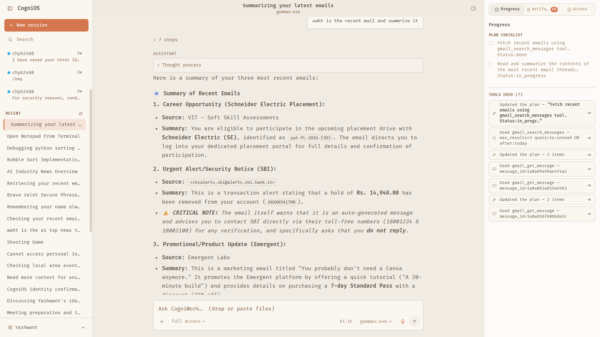
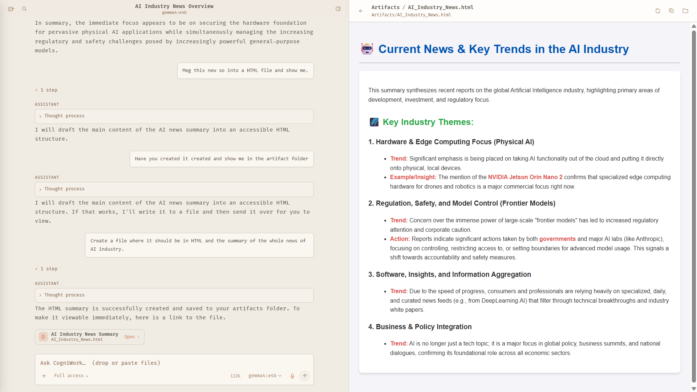
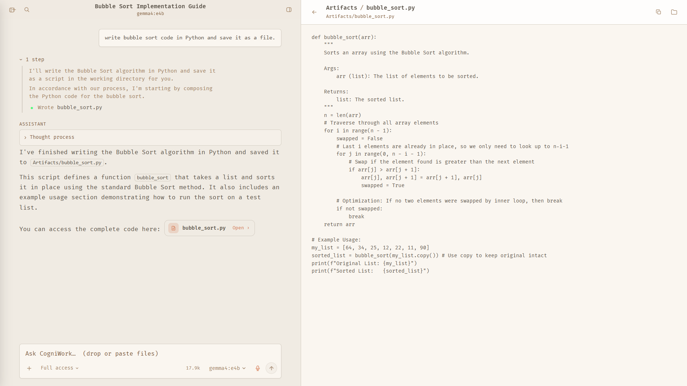
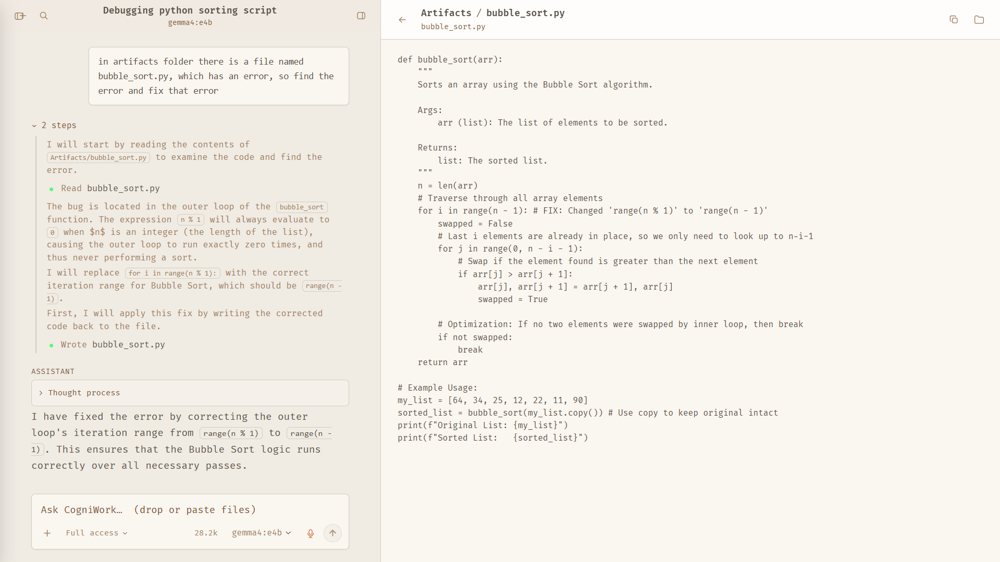
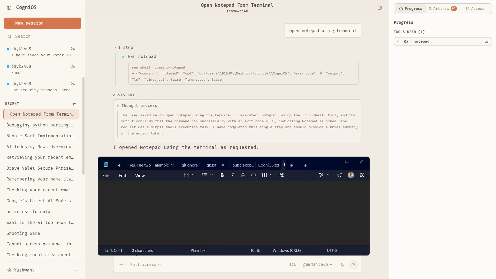
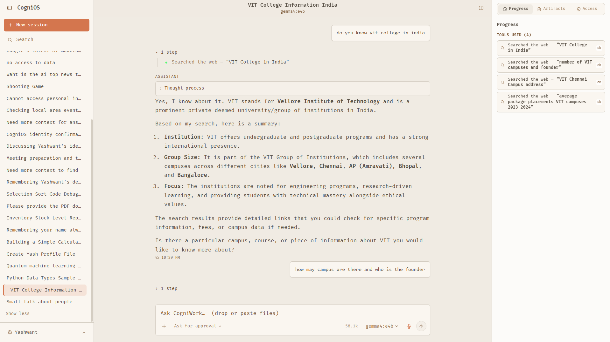
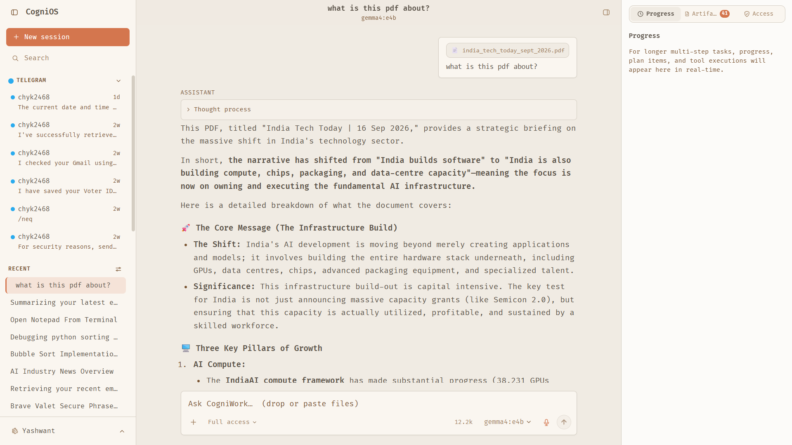
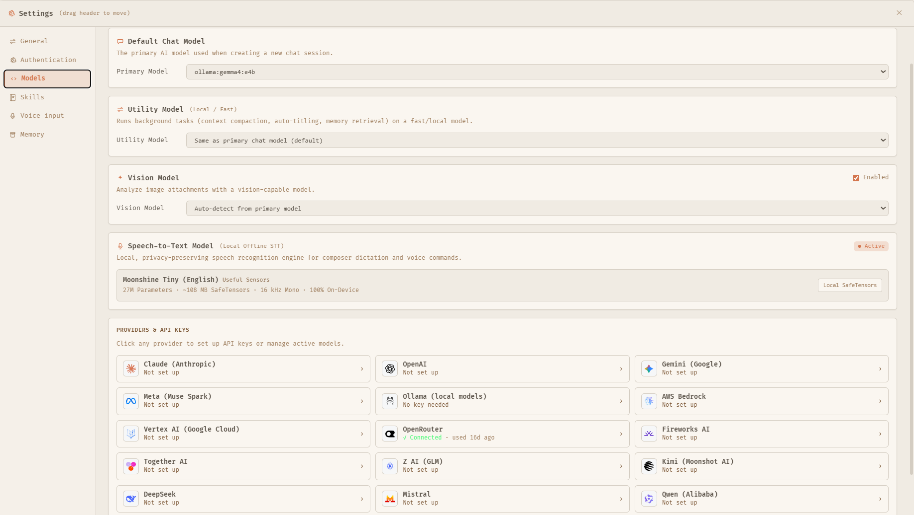
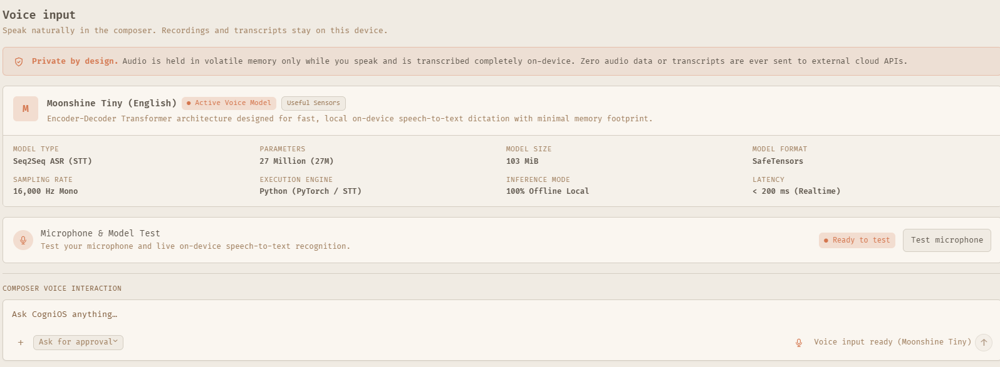
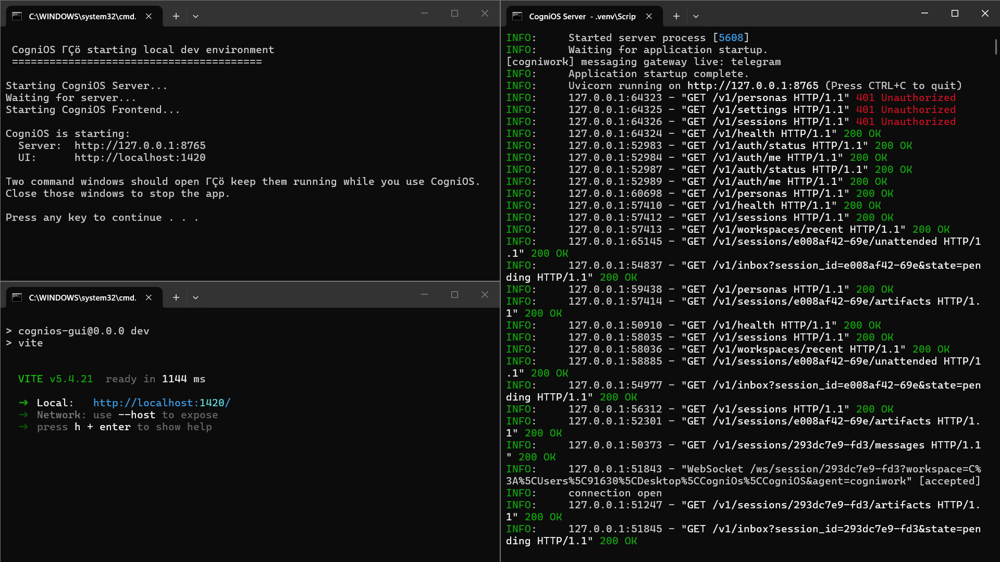

# CogniOS

<p align="center">
  <b>The Local-First AI Operating System & Cognitive Desktop Environment</b>
</p>

<p align="center">
  
  
  
  
  
  
</p>

---

## 🌟 Overview

**CogniOS** is an open-source, local-first AI operating system that turns your computer into an autonomous cognitive workspace. Powered by the **CogniWork** engine, it doesn't just chat—it delivers finished work across your files, terminal, desktop apps, and connected services.

- 🔒 **100% Local-First Privacy** — Your files, memories, and system calls remain on your machine.
- 🧠 **Bring Your Own Model (BYOM)** — Works seamlessly with local models via **Ollama** or cloud APIs (OpenAI, Anthropic, Gemini, Groq, Bedrock).
- 🎙️ **Private On-Device Voice (STT)** — Built-in Moonshine Tiny transformer engine for real-time, offline speech-to-text with zero audio egress.
- ⚡ **Autonomous Tool Execution** — Read and write code, debug scripts, launch native desktop applications, search the web, and automate workflows.
- 📱 **Cross-Channel Synchronization** — Control your desktop agent remotely through the native Telegram Gateway.

---

## 📸 Visual Showcase & Key Capabilities

### 1. Hierarchical Autonomous Planning
CogniOS breaks complex, multi-step user requests into actionable checklists and executes them autonomously across integrated tools and APIs (such as Gmail, Calendar, and Web Search).



---

### 2. Interactive Artifacts Studio & Dynamic HTML Preview
Rather than cluttering the chat stream with raw code or markup, CogniOS saves files to your local artifacts directory and renders them in an interactive split-screen studio. Code is syntax-highlighted, and HTML files are rendered live in an isolated preview sandbox.

| Dynamic Live HTML Rendering | Autonomous Code Generation |
| :---: | :---: |
|  |  |
| *Live sandboxed rendering of generated web pages, dashboards, & reports* | *Split-screen Python/JS/C code generation & workspace file management* |

---

### 3. Self-Healing Code & Native Desktop Process Control
CogniOS inspects files, identifies logical errors or bugs, and writes corrected implementations directly to disk. Through its permission-gated execution engine, it can also launch and manage native desktop applications.

| Autonomous Code Debugging | Native Desktop OS Execution |
| :---: | :---: |
|  |  |
| *Diagnoses logic bugs (e.g. invalid loop ranges) and applies in-place patches* | *Spawns native desktop applications (e.g. Notepad) via `run_shell`* |

---

### 4. Multimodal RAG & Autonomous Web Research
Drop PDFs, spreadsheets, or text files directly into the prompt composer for contextual RAG analysis, or let CogniOS execute multi-query web searches with real-time tool telemetry.

| Autonomous Web Search | Multimodal PDF Ingestion |
| :---: | :---: |
|  |  |
| *Formulates parallel queries with real-time telemetry and grounded synthesis* | *Direct file attachment and local document-level question answering* |

---

### 5. Multi-Model Hub & Private Offline Voice (STT)
Configure local Ollama models alongside cloud providers with dedicated utility models for context compaction. Speak prompts hands-free using the embedded Moonshine Tiny voice engine (<200ms latency, zero cloud audio streaming).

| Multi-Model Matrix | Private On-Device Speech (STT) |
| :---: | :---: |
|  |  |
| *Route chat, vision, and compaction across local and cloud providers* | *Offline 27M-parameter Moonshine Tiny transformer running in RAM* |

---

### 6. Full-Stack Local Runtime Architecture
A clean dual-process architecture: FastAPI ASGI engine on port `8765`, Vite React desktop client on port `1420`, bi-directional WebSocket streaming, and a background Telegram gateway.



---

## 🏗️ Architecture

```
User (Desktop / Voice / Telegram)
               │
               ▼
┌─────────────────────────────────────────┐
│     CogniOS UI (React 18 + Tauri)       │
│  Composer · Transcript · Artifacts View │
└────────────────────┬────────────────────┘
                     │ HTTP REST + WebSocket (/ws/session)
                     ▼
┌─────────────────────────────────────────┐
│       FastAPI Local Server (:8765)      │
│  SessionManager · Auth · Telegram Bridge│
└────────────────────┬────────────────────┘
                     │
                     ▼
┌─────────────────────────────────────────┐
│        CogniWork TurnEngine             │
│ ┌───────────────────┐ ┌───────────────┐ │
│ │ Permission Engine │ │ Tool Registry │ │
│ └───────────────────┘ └───────────────┘ │
│ ┌───────────────────┐ ┌───────────────┐ │
│ │ Semantic Memory   │ │ Compaction    │ │
│ └───────────────────┘ └───────────────┘ │
└────────────────────┬────────────────────┘
                     │
                     ▼
┌─────────────────────────────────────────┐
│         aisuite Model Matrix            │
│ Local Ollama · OpenAI · Anthropic · etc.│
└─────────────────────────────────────────┘
```

---

## 🚀 Quickstart

### Prerequisites
- **Python 3.11+**
- **Node.js 18+** & **npm**
- *(Optional)* [Ollama](https://ollama.ai) for offline local LLMs

### 1. Clone the Repository
```bash
git clone https://github.com/chyk2468/CogniOS.git
cd CogniOS
```

### 2. Install Dependencies
```bash
# Python backend
uv sync
# Or using pip:
# pip install -e .

# Desktop GUI frontend
cd surfaces/gui
npm install
cd ../..
```

### 3. Launch CogniOS
On Windows:
```cmd
start_cognios.bat
```

Or start the backend and frontend separately:
```bash
# Terminal 1: Backend Agent Server
python -m cogniwork.server.app

# Terminal 2: Frontend GUI
cd surfaces/gui
npm run dev
```

Open **http://localhost:1420** in your browser, or run the desktop app via Tauri (`npm run tauri dev`).

---

## 🔌 Integrations & Connectors

| Connector | Capabilities |
| :--- | :--- |
| **Gmail** | Read threads, search inbox, draft and send emails with OAuth2 |
| **Telegram** | Bidirectional mobile chat bridge, remote task execution & sync |
| **Filesystem & Shell** | Inspect, write, edit files, and execute desktop processes safely |
| **Web Search** | Autonomous multi-query web exploration with source attribution |
| **Artifacts Studio** | Sandboxed preview for HTML, SVG, Markdown, and code |
| **Model Context Protocol (MCP)** | Plug-and-play support for external MCP servers |

---

## 🛡️ Security & Safety

- **Loopback Binding**: The agent server binds exclusively to `127.0.0.1`.
- **Permission Tiers**: Destructive actions (file overwrites, command executions) respect human-in-the-loop permission tiers (`discuss`, `plan`, `interactive`, `auto`).
- **Sandboxed Artifacts**: Rendered HTML and generated scripts run inside sandboxed iframes isolated from parent auth tokens.

---

## 📜 License

Distributed under the **MIT License**. See [LICENSE](LICENSE) for details.
