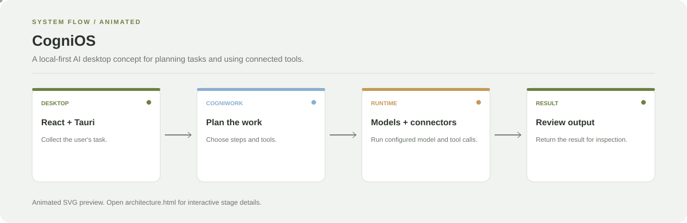

# CogniOS

**A local-first AI desktop concept for planning tasks and using connected tools.**

[](https://github.com/chyk2468/CogniOS)

## 1. Project Title & Tagline

A local-first AI desktop concept for planning tasks and using connected tools.

## 2. Problem Statement

AI desktop workflows often split task planning, model access, tools, and output review across different interfaces. CogniOS aims to bring those steps into a coherent desktop experience.

## 3. Project Preview

Add a screenshot or GIF of the current implementation. If the app is not runnable yet, use a clearly labelled concept mock-up instead of implying a live demo exists.

[Open interactive architecture](architecture.html)

## 4. Overview

The project groups the main stages from user input to planning, processing, and reviewable output.

## 5. Key Features

- Desktop interface built around user intent.
- Task planning through the CogniWork runtime.
- Configured model providers and tool connectors.
- Reviewable outputs and task results.

## 6. Architecture / Workflow



Open the [interactive architecture explorer](architecture.html) to select a stage and inspect its role.


## 7. Tech Stack

React, TypeScript, Tauri, and the model/runtime integrations configured by the project

## 8. Installation & Setup

```bash
git clone https://github.com/chyk2468/CogniOS.git
cd CogniOS
```

Follow the repository's package and desktop build instructions, install the required runtime, and configure the model provider or local runtime.

## 9. Usage

Start the desktop app using the documented development command, submit a small task, and inspect the planned steps and final output. Review tool permissions before connecting external services.

## 10. Project Structure

Inspect the desktop frontend, Tauri configuration, CogniWork runtime, model-provider adapters, and tool connectors.

## 11. Results & Demo

Add a short desktop demo showing task planning, tool execution, and a finished result. Document which providers and connectors are enabled in the tested build.

## 12. Future Enhancements

- Add clearer permission and confirmation screens.
- Improve task progress and failure recovery.
- Add evaluation tests for common task flows.
- Document local-only and external-provider modes.

## 13. License

Check the repository and bundled dependencies for licence terms before reuse.
